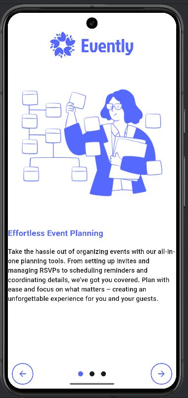
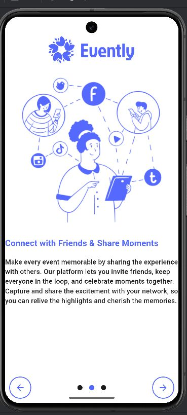
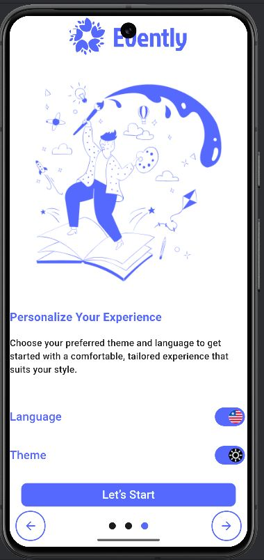
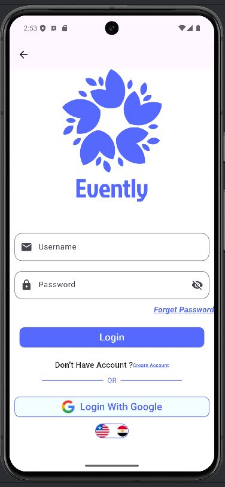
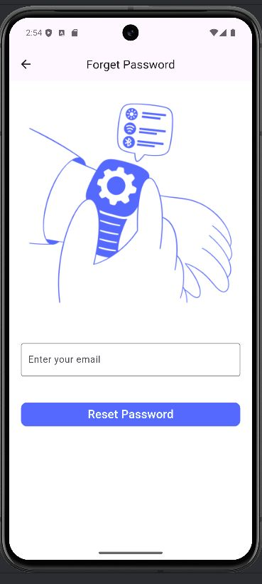
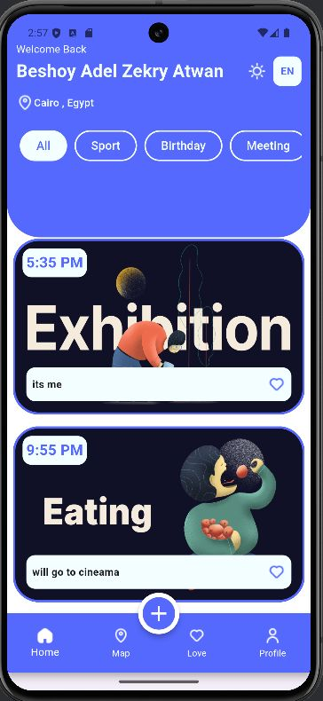
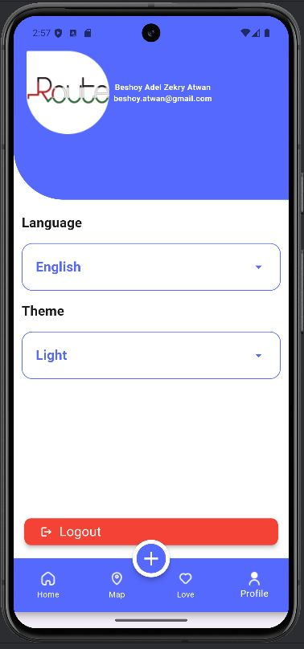
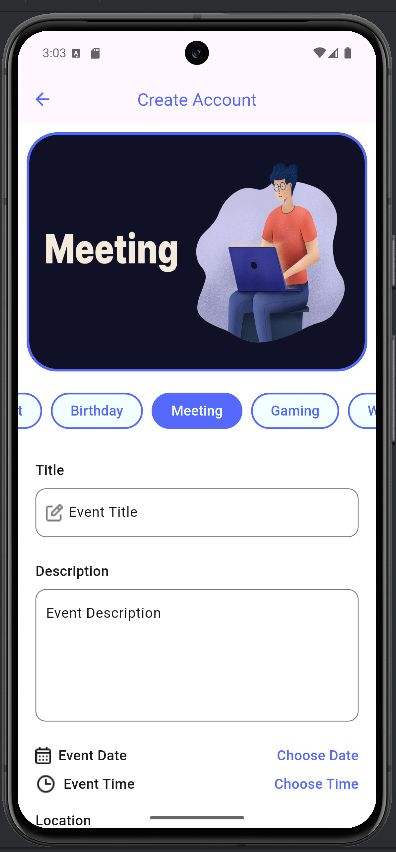

# Evently

An event management app built with Flutter: create, browse and join events with categories, maps and full localization.

## Features

- Create and manage your own events
- Browse events by category (sports, music, workshops and more)
- Event location on Google Maps
- Favorites list
- Light and dark themes
- English and Arabic localization

## Tech Stack

- Flutter & Dart
- Firebase: Authentication and Cloud Firestore
- Google Maps Flutter
- State management: provider + riverpod

## Getting Started

```bash
flutter pub get
flutter run
```

## Screenshots

Original Evently app screenshots from the [project post](https://www.linkedin.com/posts/beshoy-adel311_flutter-evently-mobileapp-activity-7295436635410690048-4GXf).









